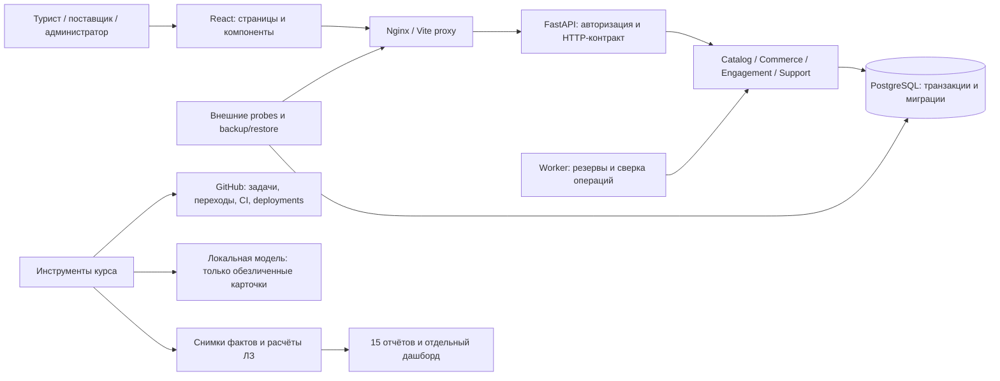

# Архитектура продукта и материалов курса

Версия 30.10.2026. Точки входа: [продукт](../README.md),
[15 лабораторных](labs/README.md), [проверки релиза](verification-results.md).

## Границы

Модульный монолит сохраняет одну транзакционную границу бронирования, оплаты
и мест. Отдельные микросервисы для лабораторных не требуются. Расчёты курса
не импортируются приложением и не имеют доступа к рабочей БД.

| Слой | Основной каталог | Ответственность |
|---|---|---|
| Интерфейс | [frontend/src/pages](../frontend/src/pages/), [components](../frontend/src/components/) | Сценарии пользователя, ru/kk/en, доступность; без самостоятельного пересчёта денег |
| HTTP | [backend/app/api](../backend/app/api/) | Схемы, роли, владение, HTTP-ответы |
| Прикладные правила | [backend/app/services](../backend/app/services/) | Серверная цена, резерв, возврат, поддержка, поиск |
| Данные | [domain](../backend/app/domain/), [migrations](../backend/migrations/) | Ограничения БД и исторические снимки; миграции добавляются последовательно |
| Интеграции | [adapters](../backend/app/adapters/), [mail service](../backend/app/services/mail_service.py) | Явный тестовый провайдер и почта; не выдаются за банковский эквайринг/SMTP |
| Эксплуатация | [scripts](../scripts/), [ops](ops/) | Проверки сервиса, backup/restore, отчёт SLI и расписания |
| Курс | [scripts/course](../scripts/course/), [docs/labs](labs/) | Получение фактов, расчёты и отчёты; отдельная команда запуска |

## Архитектура документов

У каждой ЛЗ есть `docs/labs/lab-NN/README.md`: цель, результат, собственные
артефакты, команды, незавершённые требования. Подробные общепроектные документы
сохраняют единственный основной экземпляр по тематике: `requirements`, `plan`,
`security`, `qa`, `ops`, `adr`. Отчёт ЛЗ ссылается на него, а не копирует.
Пакет ЛЗ8 остаётся в историческом `docs/lab-8`, чтобы сохранить действующие ссылки.

| Вид | Место | Правило |
|---|---|---|
| Требования методички | [manifest.json](labs/manifest.json) | Один ID на каждый нумерованный шаг; исходник и его SHA-256 |
| Отчёт отдельной ЛЗ | `docs/labs/lab-NN/README.md` | Вход, метод, результат, доказательства, границы |
| Снимки источников | [общие факты](labs/evidence/), `lab-NN/evidence` | Дата получения, источник, параметры; секреты исключены |
| Данные расчётов | [data/labs](../data/labs/) | Наблюдения отделены от оценок и допущений |
| Notebook / eval | [notebooks](../notebooks/), [evals](../evals/) | Воспроизводимый запуск, версия, параметры и сырые ответы |
| Историческая версия | `lab-NN/archive` | Не становится актуальным фактом; дата сохранена |
| Навигация | [оглавление](labs/README.md), [портфолио](portfolio/final-portfolio.md) | Ссылки на все 15 работ и общий статус |

## Направление данных и проверка

`github_facts` только читает API. `metrics` считает поток и DORA; зелёный CI
не превращается в deployment. `forecast` использует наблюдаемую недельную
историю. `ai` хранит ответы и серверные token counts; разметка ассистентом
не объявляется человеческим эталоном. `weekly_status` пишет черновик в файл,
не отправляет его заказчику. `dashboard` читает зафиксированные результаты,
не создаёт факты и не меняет туристическое приложение.

`scripts.course.audit` проверяет структуру и ссылки отдельно от завершения
курса. С `--require-complete` он возвращает ошибку, пока отсутствуют интервью,
независимая разметка, UAT или другие обязательные подтверждения людей.

Крупные финансовые XLSX/ODS, DOCX и презентации — публикуемые представления
расчёта. Источник чисел и дата версии указываются в отчёте ЛЗ; бюджетный план
не заменяет бухгалтерский факт. Изменение учебного документа не меняет
порогов эксплуатационного SLA задним числом.
