# ER-модель и обоснование третьей нормальной формы

Текущая схема: 36 таблиц, миграции `0001 → 0002 → 0003 → 0004`. История MVP
не удаляется: `0001_initial.py` остаётся исходной схемой. Словарь колонок,
ключей, CHECK и индексов: [postgresql-schema.md](postgresql-schema.md).
Результаты запусков: [verification-results.md](verification-results.md).

```mermaid
erDiagram
    USERS ||--o{ EXPERIENCES : publishes
    USERS ||--o{ BOOKINGS : books
    USERS ||--o{ REVOKED_ACCESS_TOKENS : revokes
    USERS ||--o{ PASSWORD_RESETS : requests
    DESTINATIONS ||--o{ DESTINATION_TRANSLATIONS : translates
    DESTINATIONS ||--o{ EXPERIENCES : contains
    CATEGORIES ||--o{ EXPERIENCES : categorizes
    EXPERIENCES ||--o{ EXPERIENCE_TRANSLATIONS : translates
    EXPERIENCES ||--o{ CATALOG_LINES : describes
    EXPERIENCES ||--o{ ITINERARY_DAYS : plans
    ITINERARY_DAYS ||--o{ ITINERARY_TRANSLATIONS : translates
    EXPERIENCES ||--o{ EXPERIENCE_IMAGES : illustrates
    EXPERIENCES ||--o{ EXPERIENCE_SERVICES : offers
    EXPERIENCES ||--o{ EXPERIENCE_CANCELLATION_RULES : sets
    EXPERIENCES ||--o{ DEPARTURES : schedules
    DEPARTURES ||--o{ BOOKINGS : reserves
    BOOKINGS ||--o{ BOOKING_PARTICIPANTS : includes
    BOOKINGS ||--o{ BOOKING_ITEMS : agrees
    EXPERIENCE_SERVICES |o--o{ BOOKING_ITEMS : originates
    BOOKINGS ||--o{ BOOKING_STATUS_HISTORY : records
    BOOKINGS ||--o{ PAYMENT_ATTEMPTS : pays
    PROVIDER_OPERATIONS ||--o| PAYMENT_ATTEMPTS : processes
    PAYMENT_ATTEMPTS ||--o{ PAYMENT_EVENTS : records
    PAYMENT_ATTEMPTS ||--o{ REFUNDS : refunds
    PROVIDER_OPERATIONS ||--o| REFUNDS : processes
    REFUNDS ||--o{ REFUND_EVENTS : records
    PROMOCODES ||--o{ PROMO_REDEMPTIONS : limits
    BOOKINGS ||--o| PROMO_REDEMPTIONS : applies
    BOOKINGS ||--o| REVIEWS : verifies
    EXPERIENCES ||--o{ REVIEWS : receives
    USERS ||--o{ FAVORITES : saves
    EXPERIENCES ||--o{ FAVORITES : saved
    USERS ||--o{ SAVED_SEARCHES : repeats
    USERS ||--o{ NOTIFICATIONS : receives
    USERS ||--o{ SUPPORT_TICKETS : opens
    BOOKINGS |o--o{ SUPPORT_TICKETS : concerns
    SUPPORT_TICKETS ||--o{ SUPPORT_MESSAGES : contains
    USERS ||--o{ AUDIT_LOGS : acts
    BOOKINGS |o--o| CURRENCY_CONVERSION_RECORDS : preserves
    EXPERIENCES |o--o| CURRENCY_CONVERSION_RECORDS : converts
```

`demo_emails` — приватный канал доставки демонстрационного адаптера.
Поставщик — пользователь с ролью vendor; отдельная таблица с теми же именем
и email не нужна, пока нет самостоятельных данных организации. Аналогично
профиль пользователя не выделен в пустую таблицу 1:1: имя и email зависят
от user ID и принадлежат одной сущности. Роль/активность проверяются на сервере.

## Ключи и функциональные зависимости

| Группа | Кандидатный ключ и зависимость | Устранение зависимостей |
|---|---|---|
| Users | `id → name,email,password_hash,role,is_active`; `email → id` | Профиль не копируется в турах и сообщениях; FK пользователя |
| Destinations, experiences | `id → slug,операционные поля`; `slug → id` | Направление и категория связаны FK, название не дублируется в турах |
| Translations | `(entity_id,language) → переводимые поля` | Зависит от полного составного ключа; нет `title_en/title_kk` в основной таблице |
| Catalog lines | `(experience_id,language,kind,position) → text` | Элементы списка — строки, не JSON-массивы идентификаторов |
| Itinerary | `(experience_id,day) → day_id`; `(day_id,language) → title,description` | Дата/номер дня не повторяются в каждом переводе; отдельный ключ дня |
| Cancellation rules | `(experience_id,days_before) → refund_percent` | Условия поставщика нормализованы; при оформлении фиксируются в договоре |
| Images, services | `id → experience_id,поля`; `(experience_id,position) → image` | Галерея и доступные услуги имеют FK и ограничения |
| Departures | `id → experience_id,start_date,end_date,capacity,price,status`; `(experience_id,start_date) → id` | Цена конкретной даты не копируется из каталога при чтении |
| Booking participants | `(booking_id,position) → name` | Каждый участник — строка; паспортные данные не собираются |
| Booking items | `id → booking_id,agreed_name,quantity,unit_amount,total,currency` | Это согласованные факты сделки, не текущая цена услуги |
| Payment/refund | `id → operation_id,booking_id,amount,currency,status`; уникальный `operation_id` | Оплата, возврат и бронь имеют независимые жизненные циклы |
| Payment idempotency | `(user_id,idempotency_key) → request_fingerprint,payment` | Один ключ не создаёт вторую операцию; partial UNIQUE для успешной оплаты брони |
| Promo | `code → правила`; `booking_id → применение,скидка` | Лимиты проверяются под блокировкой промокода; связующая redemption |
| Reviews | `booking_id → review`; `id → rating,text,moderation` | Одна запись на завершённую поездку; автор и тур проверены по брони |
| Favorites | `(user_id,experience_id) → created_at` | Полный составной PK запрещает повтор |
| Support | `ticket_id → owner,subject,status`; `message_id → ticket,author,body` | Ответы — отдельные строки с автором и правами доступа |

В реляционном ядре атрибуты зависят от кандидатного ключа, полного ключа
и не зависят транзитивно от другого неключевого атрибута. Суррогатные ID
дополнены натуральными UNIQUE там, где существует бизнес-уникальность.
Не все бизнес-правила выражаются одиночным CHECK: остаток мест, сумма
возвратов и лимит промокода проверяются транзакциями PostgreSQL.

## Исторические документы и проекции

`experience_snapshot`, согласованные позиции, даты и условия отмены —
самостоятельный неизменяемый документ сделки. Снимок не обновляется
из каталога. JSON в снимке и политике не заменяет FK участников или услуг.
`subtotal_amount`, `discount_amount`, `total_amount` — контролируемые
сервером итоги; CHECK проверяет равенство и неотрицательность.

`rating/review_count` — кэш агрегата одобренных отзывов. Источник истины —
`reviews`, пересчёт выполняется при модерации. Старые случайные деморейтинги
обнулены миграцией; частное demo-наполнение создаёт связанные завершённые
поездки и отзывы. `is_published` — совместимое представление публикации;
состояние проверено CHECK и синхронизируется сервером.

Параметры сохранённого поиска и детали аудита — самостоятельные документы
с валидацией разрешённых полей, не списки реляционных идентификаторов.

## Сохранение MVP и денег

Миграция переносит переводы, строки программы и услуг перед удалением
прежних столбцов. Каталог USD и его выезды пересчитываются ×500 с записью
учебного правила. Старые брони сохраняют исходную валюту и сумму; отдельная
conversion-запись содержит KZT-эквивалент. Для прежних статусов не создаётся
фиктивная оплата. Старый pending получает истёкший срок резерва, поэтому
не блокирует новые продажи. Истории статусов и избранное сохраняются.

В текущей рабочей базе до изменения было 2 пользователя, 24 направления,
24 тура и 0 броней. Поэтому дополнительно существует PostgreSQL-тест
`test_migrations.py` с четырьмя историческими USD-бронированиями разных
состояний. Он проверяет сохранение сделки и отсутствие вымышленных оплат.
