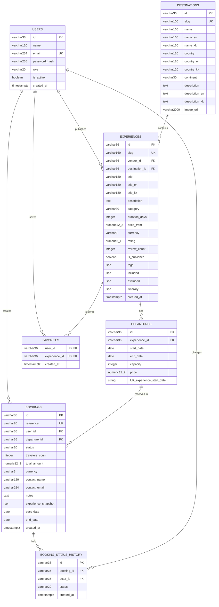

# ER-модель базы данных SaparTravel

Модель построена по миграции `backend/migrations/versions/0001_initial.py` и
проверена по созданной PostgreSQL 17 базе в Docker.

## Диаграмма связей

## Ключи и ограничения

| Таблица | Первичный ключ | Внешние ключи | Уникальность / проверки |
|---|---|---|---|
| `users` | `id` | — | `email`; роль `traveler/vendor/admin` |
| `destinations` | `id` | — | `slug`; индекс `continent` |
| `experiences` | `id` | `vendor_id → users.id`, `destination_id → destinations.id` | `slug`; длительность 1–90; цена ≥ 1; рейтинг 0–5 |
| `departures` | `id` | `experience_id → experiences.id` | `(experience_id, start_date)`; capacity 1–1000; end ≥ start |
| `favorites` | `(user_id, experience_id)` | `user_id → users.id`, `experience_id → experiences.id` | повторное избранное невозможно; удаление связи каскадное |
| `bookings` | `id` | `user_id → users.id`, `departure_id → departures.id` | `reference`; статус `pending/confirmed/cancelled/completed`; 1–20 путешественников |
| `booking_status_history` | `id` | `booking_id → bookings.id`, `actor_id → users.id` | история связывает бронь и пользователя, изменившего статус |

## Правило бронирования

При создании бронирования API блокирует строку `departures` через
`SELECT ... FOR UPDATE`, считает активные заявки и проверяет остаток мест.
Цена и итоговая сумма рассчитываются сервером. `experience_snapshot` сохраняет
условия тура на момент создания заявки, поэтому последующие изменения каталога
не меняют уже оформленную бронь.

## Фактическая проверка Docker PostgreSQL

На стенде создана база `sapartravel` в контейнере `postgres:17-alpine`.
Миграция `0001` применена, seed завершён без перезаписи существующих данных:

| Таблица | Записей |
|---|---:|
| `users` | 2 |
| `destinations` | 24 |
| `experiences` | 24 |
| `departures` | 72 |

Публичный локальный порт PostgreSQL — `127.0.0.1:55432`, потому что порт
`5432` уже был занят локальным экземпляром PostgreSQL. Внутри Docker-сети API
подключается к `db:5432`.

