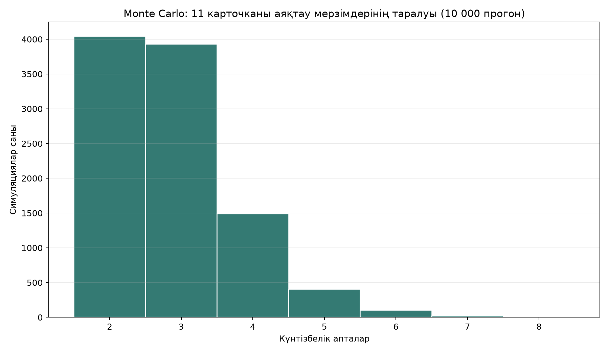
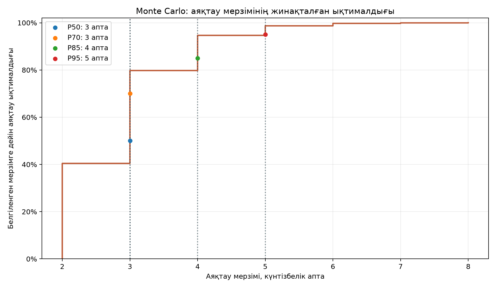

# ЛЗ 6. Бағалау нәтижелері, инсайт және қалыптасқан құзыреттер

## Кіріспе

SaparTravel жобасындағы алтыншы зертханалық жұмыстың негізгі мақсаты аяқталмаған жұмыс көлемін бір ғана күнмен емес, ықтималдықтар диапазонымен бағалау болды. Жоспарлау кезінде қолданылған WBS, story points және capacity көрсеткіштері жобаның көлемін сипаттайды, алайда олардың ешқайсысы нақты аяқталу күнін өздігінен қамтамасыз етпейді. Нақты мерзімге әсер ететін белгісіздік throughput өзгерісі, нөлдік өнімділік апталары, талаптардың нақтылануы және сыртқы тәуелділіктер арқылы көрінеді.

Монте-Карло әдісі белгісіздікті арифметикалық ортаға жасырып қоймай, көптеген ықтимал даму траекториялары арқылы көрсетуге мүмкіндік берді. Есептеудің нәтижесі тапсырыс берушіге «жоба дәл осы күні аяқталады» деген уәде емес, белгілі бір мерзімге дейін аяқталу ықтималдығы түрінде ұсынылады. Мұндай тәсіл жоспарлық міндеттемені, ішкі командалық бағдарды және ықтимал тәуекел резервін ажыратуға жағдай жасайды.

## Деректер және есептеу шарттары

Есепке `data/throughput.csv` файлының алғашқы 15 апталық мәні алынды. Қатар әдістемелік мысал ретінде қолданылды және SaparTravel командасының толық фактілік тарихы болып саналмайды. Алғашқы 15 мәннің ішінде екі нөлдік апта сақталды, себебі тоқтап қалу кезеңдерін алып тастау болашақтағы тәуекелдің оң жақ құйрығын жасанды түрде қысқартады.

| Көрсеткіш | Мәні |
|---|---:|
| Есепке алынған апталар | 15 |
| Throughput мәндерінің қатары | 4, 6, 0, 7, 5, 2, 6, 9, 4, 5, 0, 6, 7, 4, 5 |
| Орташа throughput | 4,67 элемент/апта |
| Медиана | 5 элемент/апта |
| Ең төменгі throughput | 0 элемент/апта |
| Ең жоғары throughput | 9 элемент/апта |
| Аяқталмаған MVP карточкалары | 11 |
| Симуляция саны | 10 000 |
| Кездейсоқ генератордың бастапқы мәні | 42 |
| Есептеу күні | 9 қазан 2026 жыл |

Модельде әр прогонда тарихи қатардан бір апталық throughput кездейсоқ таңдалып, жиналған орындалған элементтер саны 11 карточкаға жеткенге дейін қайталанды. Әр прогон аяқталу мерзімінің жеке сценарийін берді. 10 000 прогоннан кейінгі үлестірімнен P50, P70, P85 және P95 квантильдері алынды.

## Монте-Карло нәтижелері

| Сенімділік деңгейі | Аяқтауға қажетті мерзім | Есептік аяқталу күні | Түсіндірме |
|---|---:|---|---|
| P50 | 3 апта | 30 қазан 2026 | Сценарийлердің кемінде жартысы осы мерзімге дейін аяқталды |
| P70 | 3 апта | 30 қазан 2026 | Сценарийлердің кемінде 70%-ы осы мерзімге дейін аяқталды |
| P85 | 4 апта | 6 қараша 2026 | Жоспарлау үшін сақтық деңгейі жоғары мерзім |
| P95 | 5 апта | 13 қараша 2026 | Сәтсіздік құны жоғары болған жағдайда қолданылатын резервті мерзім |

Симуляциялардағы орташа аяқталу ұзақтығы `2,87` апта болды. Кәдімгі орташа throughput арқылы жасалған есеп `11 / 4,67 = 2,36` апта нәтижесін береді. Екі көрсеткіштің айырмасы орташа арифметиканың тоқтап қалу апталарын, әлсіз өнімділік кезеңдерін және кездейсоқ ауытқуларды толық сипаттай алмайтынын көрсетеді. Монте-Карло үлестірімі мерзімді бір санға дейін қысқартпайды, сондықтан жоспарлау шешіміне қажетті тәуекел деңгейін таңдауға мүмкіндік береді.

*1-сурет. 11 аяқталмаған MVP карточкасын аяқтау мерзімдерінің 10 000 симуляциядағы таралуы.*

Гистограммада ең жиі кездесетін мерзімдер үш және төрт апта маңында шоғырланған. Нөлдік throughput бар апталар сирек кездесетін ұзақ сценарийлерді қалыптастырып, таралудың оң жақ бөлігін кеңейтеді. Қысқа мерзімді сценарийлердің болуы тапсырыс берушіге сол мерзімді міндетті нәтиже ретінде ұсынуға негіз бермейді, себебі P50 тек ықтималдықтың медианалық деңгейін білдіреді.

*2-сурет. Аяқталу мерзімі мен оны орындау ықтималдығы арасындағы байланыс.*

Жинақталған қисық кез келген мерзім үшін бэклогтың аяқталу ықтималдығын оқуға мүмкіндік береді. P85 нүктесінде 11 карточканың төрт апта ішінде аяқталу ықтималдығы 85%-ға жетеді, ал қалған 15% сценарий бесінші аптаға немесе одан да ұзақ мерзімге өтеді. Тапсырыс берушіге ұсынылған 6 қараша күні осы себеппен медианалық 30 қазан күнінен сенімдірек басқару нүктесі ретінде таңдалды.

## Story points бағасымен салыстыру

Planning Poker хаттамасында ST-01–ST-10 аралығындағы он тарихтың жиынтық бағасы 58 SP болды. Монте-Карло есебіне кіретін аяқталмаған 11 карточка басқа жиынтықтан тұрады: ST-04, ST-05, ST-06, ST-08–ST-15. Сол карточкалардың оқу бағасы 57 SP құрайды. Екі мәнді бір backlog ретінде қарастыру дұрыс емес, себебі олардың құрамдары әртүрлі.

Қалған 11 карточка үшін шартты velocity `8 SP/апта` деп алынғанда, детерминирленген есеп `57 / 8 = 7,125` апта, яғни жоғары қарай дөңгелектегенде 8 апта береді. Нәтиже Монте-Карлоның P85 бойынша төрт апталық мерзімінен айтарлықтай ұзын көрінеді. Себептердің бірі — 8 SP/апта нақты бақылау нәтижесі емес, оқу сценарийі ретінде енгізілген болжам. Екінші себеп — throughput әдісі барлық карточкаларды салыстырмалы түрде бірдей элемент деп қабылдаса, story points көлем, күрделілік және белгісіздікті бір шкалаға біріктіреді. Үшінші себеп — WBS, story points және throughput бірдей өлшем бірлігі емес.

| Бағалау тәсілі | Есеп | Нәтиже | Әдістемелік мәртебе |
|---|---|---:|---|
| Орташа throughput | `11 / 4,67` | 2,36 апта | Орташа бағдар, сенімділік деңгейі көрсетілмейді |
| Story points / шартты velocity | `57 / 8` | 8 апта | Оқу сценарийі, нақты velocity емес |
| Monte Carlo P50 | 10 000 прогонның 50%-ы | 3 апта | Медианалық ықтимал мерзім |
| Monte Carlo P85 | 10 000 прогонның 85%-ы | 4 апта | Тапсырыс берушімен жоспарлауға қолайлы деңгей |
| Monte Carlo P95 | 10 000 прогонның 95%-ы | 5 апта | Жоғары резервті тәуекел сценарийі |

Салыстырудың практикалық мәні бір әдісті екіншісінен артық деп жариялауда емес. Детерминирленген story points есебі көлем мен команданың шартты жылдамдығын байланыстырады, ал Монте-Карло тарихи throughput өзгерісін сақтай отырып мерзімнің ықтимал таралуын көрсетеді. Команда бірнеше нақты спринт өткізгеннен кейін story points бойынша velocity диапазонын және карточкалардың throughput қатарын жеке-жеке жаңарту қажет.

## Planning Poker нәтижесінен алынған инсайттар

Planning Poker раунды Fibonacci шкаласы бойынша жүргізіліп, әр қатысушы бағасын талқылауға дейін дербес көрсету қағидасына сүйенді. Төрт дауыстың ең үлкен айырмасы ST-04, ST-06, ST-08 және ST-09 тарихтарында байқалды. Жоғары баға қойған қатысушылар жасырын тәуелділіктерді, рөлдік тексерулерді немесе қосымша бизнес-сценарийлерді есепке алған; төмен баға қойғандар негізгі техникалық жолмен шектелген.

| Тарих | Негізгі айырмашылық себебі | Нақтыланған шекара |
|---|---|---|
| ST-01 | Пагинацияны каталогтың міндетті бөлігі деп қабылдау | Тек жарияланған турларды көрсету; қосымша пагинацияны енгізбеу |
| ST-04 | Пікірлер, редакторлық процесс және толық аударма туралы белгісіздік | Қолда бар деректерден бағдарлама мен шарттарды көрсету |
| ST-05 / ST-06 | Параметр таңдау мен орындарды нақты резервтеуді араластыру | Таңдау, қалдықты тексеру және бәсекелес брондау қадамдарын бөлу |
| ST-08 | Тур иесін тексеру және сыртқы синхрондау көлемінің белгісіздігі | Өз турларын басқару және иелік тексеруі; сыртқы синхрондауды алып тастау |
| ST-09 | Email/SMS хабарламаларын статус өзгерісімен бірге бағалау | Статус пен тарихты қалдыру; хабарламаларды MVP-ден шығару |

Раунд нәтижесі жұмыс көлемін өлшеуден бұрын тарихтың аяқталу критерийлерін нақтылау қажет екенін көрсетті. Бағалар арасындағы алшақтықты арифметикалық орташамен жасыру орнына оның себебін талдау талаптардың жетіспейтін бөлігін табуға көмектеседі. Story point мәні нақты сағатқа айналмайды және команда velocity-сін көтеру үшін мақсатты көрсеткіш ретінде қолданылмауы тиіс.

## Негізгі инсайттар

### Ықтималдық бір күннен пайдалырақ

Аяқталу күнін бір мәнмен көрсету белгісіздікті жасырады. P50 деңгейіндегі 30 қазан күні команданың жарты ықтимал сценарийін ғана жабады, сондықтан оны сыртқы міндеттеме ретінде қолдану тәуекелді. P85 деңгейіндегі 6 қараша күні басқарылатын резервті қамтиды және тапсырыс берушімен келісілетін жоспарлық нүкте ретінде негіздірек көрінеді. P95 деңгейіндегі 13 қараша күні міндеттеменің сәтсіздік құны өте жоғары болған жағдайға арналған.

### Дерек сапасы болжам сапасын анықтайды

Симуляцияның математикалық дұрыстығы бастапқы қатардың сапасын алмастыра алмайды. Қолданылған throughput оқу мысалы болғандықтан, алынған күндер SaparTravel-дің нақты өндірістік болжамы емес. Жоба бойынша бірнеше толық спринттің аяқталған карточкалары, cycle time, WIP және блокталған элементтердің жасы жиналғаннан кейін модельдің сенімділігі артады.

### Нөлдік апта тәуекелдің бөлігі болып саналады

Нөлдік throughput мәндерін алып тастау есепті жасанды түрде оптимистік етеді. Қолжетімсіз орта, келісу күтуі, оқу жүктемесі немесе сыртқы тәуелділік сияқты себептер кейбір апталарда аяқталған жұмыстың болмауына әкелуі мүмкін. Нөлдік кезеңдерді қатарда сақтау P85 пен P95 деңгейлерін жоспарлау кезінде тәуекел резервін нақтырақ көруге мүмкіндік береді.

### Бағалау, міндеттеме және жоспар бір ұғым емес

Story points пен Monte Carlo нәтижелері бағалау ақпаратын береді. Міндеттеме қабылдау кезінде өнім көлемі, сапа шегі, команда қолжетімділігі және сыртқы тәуелділіктер туралы басқарушылық шешім қабылданады. Жоспар осы шешімді инкременттерге, бақылау күндеріне және қайта есептеу шарттарына айналдырады. Үш ұғымды араластырмау тапсырыс берушінің күткен нәтижесін дұрыс басқаруға мүмкіндік береді.

### Өлшем бірліктерін араластырмау қажет

171 адам-сағаттық WBS көлемі, 57 SP story points және апталық throughput бір-бірін тікелей алмастырмайды. WBS еңбек сыйымдылығын жоспарлауға, story points салыстырмалы күрделілікті бағалауға, throughput аяқталған элементтер ағынын бақылауға арналған. Әдістерді салыстыру кезінде олардың мақсаты мен өлшем бірлігін бөлек көрсету қорытындының дұрыстығын сақтайды.

## Қалыптасқан құзыреттер

### Ықтималдық бағалау және белгісіздікпен жұмыс

Бір ғана нүктелік болжамның орнына P50, P70, P85 және P95 деңгейлерін есептеу дағдысы қалыптасты. Әр квантильдің басқарушылық мағынасы ажыратылды: медиана ішкі бағдар ретінде, P85 тапсырыс берушімен талқыланатын жоспар ретінде, P95 жоғары резервті міндеттеме ретінде қарастырылады. Сенімділік деңгейін атамай тұрып мерзім айтуға болмайтыны практикалық ереже ретінде бекітілді.

### Python және деректерге негізделген модельдеу

CSV деректерін тексеру, throughput қатарының орташа, медианалық, ең төменгі және ең жоғары мәндерін есептеу, кездейсоқ генераторды бекіту және 10 000 прогонды қайталап орындау тәжірибесі нығайды. `seed=42` параметрі бірдей бастапқы шарттарда бірдей нәтижеге жетуге мүмкіндік береді. Notebook құрылымы дерек жүктеу, симуляция, квантиль есептеу, графиктер және шектеулерді түсіндіру кезеңдеріне бөлінді.

### Нәтижені визуалды түсіндіру

Гистограмма мерзімдердің қай аралықта шоғырланғанын көрсетеді, ал жинақталған ықтималдық қисығы белгілі бір мерзімге дейін аяқтау мүмкіндігін оқуға жағдай жасайды. Графиктерді тек иллюстрация ретінде емес, шешім қабылдау құралы ретінде қолдану құзыреті қалыптасты. P85 нүктесін қисық пен кесте арқылы қатар көрсету нәтижені техникалық емес аудиторияға түсіндіруді жеңілдетеді.

### Салыстырмалы бағалау әдістерін ажырату

Story points, velocity, throughput және WBS арасындағы айырмашылықтар талданды. Planning Poker көлемнің салыстырмалы бағасын берсе, Monte Carlo аяқталмаған элементтер санын тарихи ағынмен байланыстырады. Әдістерден алынған сандарды механикалық түрде қосу немесе бір-біріне аудару орнына әр есептің қолданылу шекарасын белгілеу кәсіби бағалау мәдениетін қалыптастырады.

### Planning Poker арқылы талаптарды нақтылау

Дербес бағалау, шеткі дауыстарды талқылау және айырмашылық себептерін тіркеу тәсілдері игерілді. ST-04, ST-06, ST-08 және ST-09 бойынша анықталған айырмашылықтар қабылдау критерийлерін, тәуелділіктерді және MVP шекарасын нақтылауға қолданылды. Planning Poker нәтижесінің құндылығы тек соңғы SP санында емес, талқылау кезінде табылған жасырын жұмыста екені байқалды.

### Тапсырыс берушімен ғылыми негізделген коммуникация

Слайдта бір ғана мерзім орнына ерте бағдар, P85 жоспары, болжам шарттары, тәуекелдер және қайта қарау күні көрсетілді. Тапсырыс берушіге ұсынылған 6 қараша 2026 жылғы күн 10 000 оқу симуляциясының 85%-дық деңгейіне негізделгенін түсіндіруге мүмкіндік туды. Жаңа карточкалар, блоктаушы тәуелділіктер немесе команда қолжетімділігінің өзгеруі болжамды қайта есептеуді талап ететіні коммуникацияның міндетті бөлігі ретінде белгіленді.

## Шектеулер және келесі қадамдар

Қолданылған throughput қатары командадан жиналған фактілік өндірістік дерек емес. Қазіргі CSV файлында 26 жол болғанымен, әдістемелік есеп алғашқы 15 мәнмен орындалды; келесі зерттеу кезеңінде дерек көзі мен алынған срезді журналға тіркеу қажет. GitHub Project пен issues мәртебелеріндегі айырмашылық та backlog көлеміне әсер етеді, сондықтан ST-04–ST-15 статустары командамен қайта расталуы тиіс.

Шартты velocity нақты спринттік бақылауларға негізделмеген. Кемінде екі немесе үш толық спринттен кейін аяқталған story points диапазоны, throughput, cycle time, WIP және блокта тұрған жұмыстардың жасы жиналуы керек. Жаңартылған қатармен P50/P70/P85/P95 қайта есептеліп, алдыңғы болжаммен салыстырылатын қысқа өзгеріс журналы жүргізілгені жөн.

Бақылау нүктелеріне 16 қазан 2026 жылғы алғашқы қайта қарау, әр инкремент соңындағы backlog тексеруі және жаңа блокер пайда болған кездегі модельді жаңарту енгізіледі. Деректердің толықтығы, карточкалардың салыстырмалылығы және аяқталған жұмыс анықтамасының тұрақтылығы сақталса, келесі болжам SaparTravel командасының нақты ағынын анағұрлым дәл сипаттайды.

## Қорытынды

ЛЗ 6 нәтижесі бағалауды бір ғана мерзімді жариялау рәсімі емес, белгісіздікті деректер арқылы басқару үдерісі ретінде түсіндіруге мүмкіндік берді. 10 000 прогонның нәтижесі 11 аяқталмаған MVP карточкасы үшін P50 деңгейінде 3 аптаны, P85 деңгейінде 4 аптаны және P95 деңгейінде 5 аптаны көрсетті. Жоспарлық ұсыныс ретінде 6 қараша 2026 жылын қолдану төрт апталық P85 сценарийіне сүйенеді, ал 30 қазан ішкі ерте бағдар ретінде қалады.

Story points арқылы жасалған 8 апталық оқу есебі мен Monte Carlo арқылы алынған ықтимал мерзімдер арасындағы алшақтық өлшем бірліктерін, деректер табиғатын және velocity-дің шарттылығын ескеруді талап етеді. Planning Poker барысында анықталған талап шекаралары мен жасырын жұмыстар бағалау сапасын арттырды. Қалыптасқан құзыреттер жобалық мерзімді дәл уәде етуге емес, дәлелді диапазон құруға, оның шарттарын ашық көрсетуге және жаңа дерек пайда болған сайын болжамды жаңартуға бағытталған.

## 7. Debugging практикумы

Debugging практикумының толық есебі, іске қосу командалары, әр қатені жеке
қайта шығару, түзету және regression тексеруі бөлек құжатта берілген:

- [Debugging есебі](debugging-lab-report.md)

## Байланысты артефактілер

- [Monte Carlo ноутбугі](../notebooks/lab-6-monte-carlo.ipynb)
- [Planning Poker протоколы](lab-6-planning-poker.md)
- [Тапсырыс берушіге арналған слайд](lab-6-customer-slide.md)
- [Throughput деректері](../data/throughput.csv)
- [WBS және релиз жоспары](plan/wbs.md)