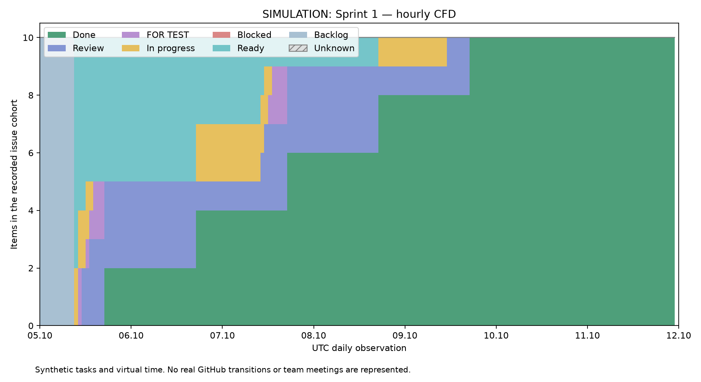

# Спринт 1 — учебная симуляция

Модельные события и виртуальные роли. Реальная работа команды этим документом не удостоверяется.

Виртуальное окно UTC: 2026-10-05 — 2026-10-12 (конец исключён). Планирование: понедельник 08:30–09:00 в виртуальном времени.

## Пользовательская цель

Сотрудник отменяет бронь с обязательной причиной, турист видит историю и сумму возврата.

## План и правила

Выбрано 10 модельных задач. Ревью: 16:00, 16:30 UTC; суммарно 60 минут в день. Разработчики A/B, QA и Reviewer — виртуальные роли. WIP: ≤2 In progress на владельца, ≤3 Review, ≤8 активных задач на команду.

DoR: цель, владелец, размер, критерий приёмки, зависимости известны. DoD в модели: реализация, успешная модельная QA-проверка, ревью другой виртуальной ролью, публикация на виртуальном стенде и обновление модельной документации. Сбои и возвраты в этом контролируемом опыте не вводятся; DoD не является заявлением о реальном стенде.

## Результаты задач

| ID | Задача | Владелец | Работа, ч | Начало цикла, UTC | Done, UTC | Цикл, ч |
|---|---|---|---:|---|---|---:|
| SIM-S1-01 | Контракт причины отмены | Developer A | 1 | 2026-10-05T09:00 | 2026-10-05T16:30 | 7.50 |
| SIM-S1-02 | Проверка прав сотрудника | Developer B | 1 | 2026-10-05T09:00 | 2026-10-05T17:00 | 8.00 |
| SIM-S1-03 | Расчёт возврата | Developer A | 2 | 2026-10-05T10:00 | 2026-10-06T16:30 | 30.50 |
| SIM-S1-04 | Транзакция отмены | Developer B | 3 | 2026-10-05T10:00 | 2026-10-06T17:00 | 31.00 |
| SIM-S1-05 | Журнал аудита | Developer A | 2 | 2026-10-05T12:00 | 2026-10-07T16:30 | 52.50 |
| SIM-S1-06 | Форма отмены | Developer B | 2 | 2026-10-06T16:30 | 2026-10-07T17:00 | 24.50 |
| SIM-S1-07 | История бронирования | Developer A | 3 | 2026-10-06T16:30 | 2026-10-08T16:30 | 48.00 |
| SIM-S1-08 | Локализация сообщений | Developer B | 2 | 2026-10-07T09:30 | 2026-10-08T17:00 | 31.50 |
| SIM-S1-09 | Отрицательные сценарии | Developer A | 2 | 2026-10-07T10:30 | 2026-10-09T16:30 | 54.00 |
| SIM-S1-10 | Проверка пользовательского пути | Developer B | 3 | 2026-10-08T16:30 | 2026-10-09T17:00 | 24.50 |

Итог модели: завершено 10; среднее 31.200 ч, p85 50.925 ч; средний WIP 1.857143.

Модельная демонстрация проверяет заявленный пользовательский результат по набору задач и принятым допущениям; реальные браузерные сценарии здесь не запускались.

[Общий отчёт и сравнение](README.md) · [Циклы всех задач](evidence/cycles.csv)
