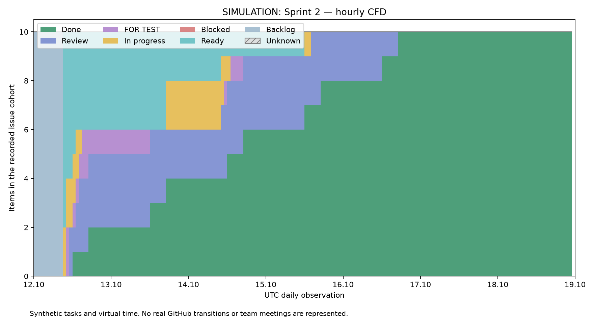

# Спринт 2 — учебная симуляция

Модельные события и виртуальные роли. Реальная работа команды этим документом не удостоверяется.

Виртуальное окно UTC: 2026-10-12 — 2026-10-19 (конец исключён). Планирование: понедельник 08:30–09:00 в виртуальном времени.

## Пользовательская цель

Пользователь получает понятную ошибку и повтор при повреждённом ответе каталога.

## План и правила

Выбрано 10 модельных задач. Ревью: 11:00, 16:00 UTC; суммарно 60 минут в день. Разработчики A/B, QA и Reviewer — виртуальные роли. WIP: ≤2 In progress на владельца, ≤3 Review, ≤8 активных задач на команду.

DoR: цель, владелец, размер, критерий приёмки, зависимости известны. DoD в модели: реализация, успешная модельная QA-проверка, ревью другой виртуальной ролью, публикация на виртуальном стенде и обновление модельной документации. Сбои и возвраты в этом контролируемом опыте не вводятся; DoD не является заявлением о реальном стенде.

## Результаты задач

| ID | Задача | Владелец | Работа, ч | Начало цикла, UTC | Done, UTC | Цикл, ч |
|---|---|---|---:|---|---|---:|
| SIM-S2-01 | Проверка JSON null | Developer A | 1 | 2026-10-12T09:00 | 2026-10-12T11:30 | 2.50 |
| SIM-S2-02 | Проверка ответа HTML | Developer B | 1 | 2026-10-12T09:00 | 2026-10-12T16:30 | 7.50 |
| SIM-S2-03 | Контракт API-клиента | Developer A | 2 | 2026-10-12T10:00 | 2026-10-13T11:30 | 25.50 |
| SIM-S2-04 | Состояние ошибки | Developer B | 3 | 2026-10-12T10:00 | 2026-10-13T16:30 | 30.50 |
| SIM-S2-05 | Кнопка повтора | Developer A | 2 | 2026-10-12T12:00 | 2026-10-14T11:30 | 47.50 |
| SIM-S2-06 | Отмена устаревшего запроса | Developer B | 2 | 2026-10-12T13:00 | 2026-10-14T16:30 | 51.50 |
| SIM-S2-07 | Локализация ошибки | Developer A | 3 | 2026-10-13T16:30 | 2026-10-15T16:30 | 48.00 |
| SIM-S2-08 | Защита от гонки ответов | Developer B | 2 | 2026-10-13T16:30 | 2026-10-15T11:30 | 43.00 |
| SIM-S2-09 | Отрицательные сценарии | Developer A | 2 | 2026-10-15T11:30 | 2026-10-16T16:30 | 29.00 |
| SIM-S2-10 | Проверка восстановления экрана | Developer B | 3 | 2026-10-14T09:30 | 2026-10-16T11:30 | 50.00 |

Итог модели: завершено 10; среднее 33.500 ч, p85 49.300 ч; средний WIP 1.994048.

Модельная демонстрация проверяет заявленный пользовательский результат по набору задач и принятым допущениям; реальные браузерные сценарии здесь не запускались.

[Общий отчёт и сравнение](README.md) · [Циклы всех задач](evidence/cycles.csv)
